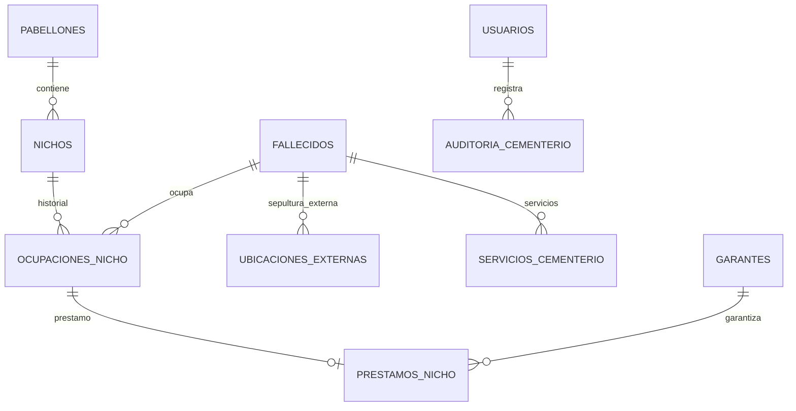

# ETAPA 2 — Modelo de datos CEMENTERIO

## Entidades principales

## Reglas implementadas en SQL

| Regla | Implementación |
|-------|----------------|
| Nicho único por pabellón + número | `UQ_NICHOS_PABELLON_NUMERO` |
| Una ocupación activa por nicho | `UX_OCUP_NICHO_ACTIVA` (filtrado `ESTADO = 'ACTIVO'`) |
| Una ocupación activa por fallecido | `UX_OCUP_FALLECIDO_ACTIVA` |
| Sepultura coop. vs externa en servicio | `CK_SERV_UBICACION` (ocupación XOR ubicación externa, o ambos NULL hasta completar) |
| 10 años desde sepultura | columna calculada `FECHA_CUMPLIMIENTO_10_ANIOS` |
| PFC / garante | snapshots en `SERVICIOS_CEMENTERIO` y `GARANTES` |

## Tabla auxiliar

- **UBICACIONES_EXTERNAS**: lugares propios fuera de los 5 pabellones (no consume `ID_NICHO`).

## Seed físico

| Pabellón | Nichos | Grid |
|----------|--------|------|
| P1 | 1–68 | 17×4 |
| P2 | **69–136** | 17×4 |
| P3 | 1–52 | 13×4 |
| P4 | 53–104 | 13×4 |
| P5 | 1–52 | 13×4 |

**Total: 292 nichos**, todos `DISPONIBLE` al inicio.

## Fuera de alcance MVP (preparado en modelo)

- `ESTADO_ARANCEL`, `FECHA_ARANCEL_DESDE` en ocupaciones.
- Estados de préstamo incluyen `CONVERTIDO_EN_ARANCEL` sin facturación.
